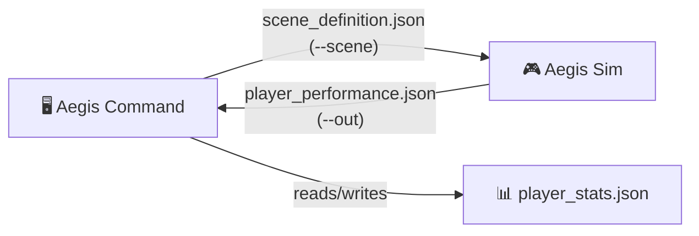

<h1 align="center">FITWING</h1>
<p align="center">
  <strong>Counter-Drone Training Suite</strong><br>
  <em>Train operators. Simulate threats. Sharpen readiness.</em>
</p>

<p align="center">
  <a href="https://drive.google.com/file/d/1yN4u2oGGq73DXaAQ0X2rnC-6TRWn9YWu/view?usp=sharing">
    
  </a>
  
  
  
</p>

---

## 🎯 What is FitWing?

**FitWing** is a professional counter-drone training suite designed for operators who need to practice threat identification, engagement, and decision-making in realistic simulated environments — all without the cost or risk of live exercises.

The suite consists of **two integrated applications**:

### 🖥️ Aegis Command — *Trainer & Campaign Manager*
> The brain of FitWing. Manage operators, design training campaigns, review AI-powered mission recommendations, and generate detailed after-action reports (PDF).

- **Operator management** — create profiles, track progress over time
- **Campaign builder** — design multi-mission training sequences
- **AI-powered recommendations** — PyTorch-based mission scoring that adapts to each operator's weaknesses
- **Dashboard & reports** — real-time stats and exportable PDF after-action reports

### 🎮 Aegis Sim — *First-Person Simulator*
> The field. A night-shift atmosphere simulation where operators man a fixed post and engage incoming drone threats using realistic equipment.

- **Immersive 3D environment** — OpenGL 3.3 core rendering with night-vision and thermal views
- **Six equipment types** — Rifle, Missile Launcher, Binoculars (auto night-vision at night), Thermal Imager, Acoustic Tablet, RF Tablet
- **Threat classification** — Identify and classify single drones, swarms, and multiple swarm formations

---

## 📥 Download

<p align="center">
  <a href="https://drive.google.com/file/d/1yN4u2oGGq73DXaAQ0X2rnC-6TRWn9YWu/view?usp=sharing">
    
  </a>
</p>

> **Release v1.0.0** — First stable release of FitWing. Download, Install, and Run.

---

## 🏗️ Project Structure

```
FitWing/
├── aegis_command/          # Trainer / Launcher application
│   ├── CMakeLists.txt
│   ├── include/
│   ├── src/
│   └── resources/
│       └── ai/             # PyTorch recommender model
│
├── aegis_sim/              # First-person simulator
│   ├── CMakeLists.txt
│   ├── include/
│   ├── src/
│   ├── shaders/            # GLSL shaders
│   └── resources/          # 3D models (.glb), textures (.png)
│
├── requirements.txt        # Full list of .glb assets with specs
└── README.md
```

---

## 🔧 Building from Source

> **Prerequisites:** CMake 3.16+, a C++17 compiler, Qt6, and optionally Python 3 + PyTorch.

### Aegis Sim (Simulator)

```bash
cmake -S aegis_sim -B build/sim \
  -DTINYGLTF_INCLUDE_DIR=<dir with tiny_gltf.h> \
  -DSTB_INCLUDE_DIR=<dir with stb_image.h> \
  [-DFITWING_DEPS_ROOT=<root with include/ lib/>]

cmake --build build/sim --config Release
```

> 💡 **Tip:** Add `-DFITWING_GLEW_STATIC=ON` to link GLEW statically.

### Aegis Command (Trainer)

```bash
cmake -S aegis_command -B build/cmd \
  [-DCMAKE_PREFIX_PATH=<Qt6 prefix>] \
  [-DFITWING_DEPS_ROOT=<root containing include/nlohmann/json.hpp>]

cmake --build build/cmd --config Release
```

> 💡 **Tip:** nlohmann JSON is resolved automatically via CMake package, system `<nlohmann/json.hpp>`, or a bare `json.hpp` — whichever is found first.

---

## 📂 Deployment

After building, assemble the deployment folder like this:

```
FitWingCommand.exe          # Trainer application
FitWingSim.exe              # Simulator application
*.dll                       # Required runtime libraries
shaders/                    # From aegis_sim/shaders/
resources/                  # From aegis_sim/resources/ (.glb / .png files)
```

**How it works:**
- The trainer launches `FitWingSim.exe` from its own directory automatically
- Qt resources (theme, Python recommender) are compiled into `FitWingCommand.exe`
- Operator profiles are saved to `AppData/` next to the exe (falls back to the user's app-data folder if not writable)

---

## 🔄 Data Flow — The Three JSON Files

FitWing uses three JSON files to coordinate between the trainer and simulator:



| File | Direction | Description |
|------|-----------|-------------|
| `scene_definition.json` | Trainer → Simulator | Mission config: `{id, mode, difficulty_level}` + all parameter options. Written to `AppData/runtime/` |
| `player_performance.json` | Simulator → Trainer | Results after mission ends or is aborted. Mission ID must match, otherwise ignored |
| `player_stats.json` | Trainer internal | Per-operator file in `AppData/players/<name>/`. Tracks 0–100 mastery scores (starting at 50) for every option |

**Scoring rule:** For each option in a mission, the update is based on `error = score − stat`. Failing an easy mission penalizes more than a hard one; succeeding at a hard mission rewards more than an easy one.

> **Note:** Mission IDs are seconds since epoch. Campaign progress and history are held in memory only (no extra files on disk).

---

## 🤖 AI-Powered Training

FitWing includes an AI mission recommender located at `aegis_command/resources/ai/recommender.py`:

- **Engine:** PyTorch-based scoring model
- **Evaluates:** ~400 valid candidate missions per recommendation cycle
- **Scores based on:**
  - 🎯 Operator weakness areas
  - 📈 Expected score (ridge regression on session history)
  - 🆕 Novelty factor (avoids repetitive scenarios)
- **Fallback:** If Python or PyTorch is unavailable, an identical C++ implementation is used automatically
- **Toggle:** Can be enabled/disabled from the Settings page

---

## 🎮 Simulator Controls

### Equipment

| Item | Description |
|------|-------------|
| 🔫 Rifle | Primary engagement weapon |
| 🚀 Missile Launcher | Heavy engagement weapon |
| 🔭 Binoculars | Observation (auto night-vision at night) |
| 🌡️ Thermal Imager | Thermal signature detection |
| 📡 Acoustic Tablet | Visual acoustic detection display |
| 📻 RF Tablet | Radio frequency detection display |

### Keybindings

| Key | Action |
|-----|--------|
| `LMB` | Raise / Lower current item |
| `RMB` | Next item |
| `Q` | Previous item |
| `Mouse Wheel` | Zoom in / out |
| `SPACE` | Act / Tag / Fire |
| `R` | Reload |
| `SHIFT` | Steady aim |
| `1` / `2` / `3` | Classify: Single / Swarm / Multiple Swarms |
| `ENTER` | Start mission |
| `ESC` | Abort mission |
| `F12` | Screenshot |

---

## ⚙️ Advanced Options

### Simulator Flags

```
--scene <file>    Mission scene file
--out <file>      Output results file
--windowed        Run in windowed mode
--width <px>      Window width
--height <px>     Window height
--msaa <samples>  Anti-aliasing samples
--norender        Disable rendering (headless)
--bot             AI-controlled operator
--shot            Auto-screenshot mode
```

### Trainer Flags

```
--selftest                Run built-in self-test
--data <dir>              Custom data directory
--screenshot <dir>        Screenshot output directory
                          (use QT_QPA_PLATFORM=offscreen)
```

---

## 📝 Known Limitations

| Area | Note |
|------|------|
| 🔇 **No audio** | No audio library was requested/available; the acoustic tablet uses a visual display instead |
| 🧪 **Training dummy mode** | Available in Settings — runs the trainer without the simulator for testing purposes. Results are labeled accordingly |

---

## 🤝 Contributing

This is a proprietary project. Please reach out to the project maintainers for contribution guidelines.

---

<p align="center">
  <sub>Built with ❤️ by the Team InnovAuraz</sub>
</p>
